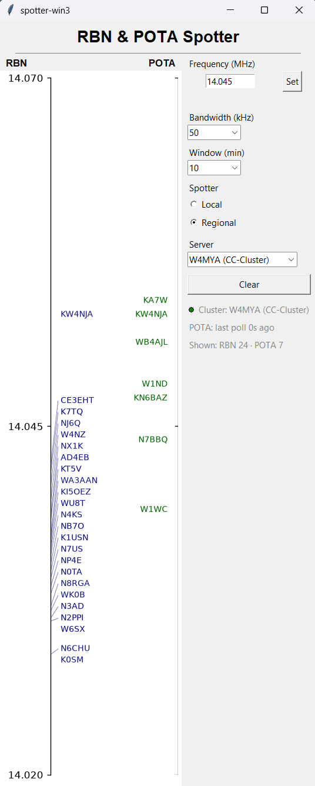

# DX Spotter (Windows): a Bandscope-style bandmap for CW, RBN and POTA



*The app on Windows 11 (live data, W4MYA cluster, Regional spotters, 14.045 MHz, 50 kHz span, 10-minute window).*

## What it is

A Windows bandmap for a CW/DX operator, modelled on the N1MM bandmap and used here as a stand-in for a Bandscope.

- **Left scale (RBN):** CW spots from a selectable telnet DX cluster, limited to the Local or Regional skimmers. Each call sign sits on a leader line to its frequency on a vertical linear scale.
- **Right scale (POTA):** CW spots from the POTA.app API, polled every minute.
- **Spots fade** over a 1, 5, 10 or 30 minute window (alpha floors at 0.15, never to zero). Clicking a call sign copies it to the clipboard.
- **Side panel:** frequency (MHz entry + Set), bandwidth, window, Local/Regional, cluster server, Clear, and a status block (connection dot, POTA poll age, shown-spot counts). The window is resizable.
- **Cluster servers:** NC7J (AR-Cluster), WA9PIE-2 (DXSpider), W3LPL (DXSpider), W4MYA (CC-Cluster). Each carries its own filter-command dialect.

The app is Python 3.13 with Tkinter and matplotlib. Run it with `python -m spotter_win3.main` (see [Try it](#try-it)).

## What this repo is really for

This repo is the **Windows build of the same pressure test** as [dx-spotter-app](https://github.com/jcarter-labs/dx-spotter-app): can Claude Code build a real-time, two-data-source app from a written masterplan and a screenshot, without the spec being written by hand?

Here the masterplan is [`masterplan-v2.md`](masterplan-v2.md), a revision of the one used for the macOS build, with a stricter Constitution (no network action before preflight is complete, one concern per commit, UI claims backed by a measurement and not a description). The build log, mistakes included, is kept alongside the code so the next masterplan can be improved from it.

## The method, in the files

| File | Role |
|---|---|
| [`masterplan-v2.md`](masterplan-v2.md) | Source of truth for the build. Four parts: **Constitution** (rules for how the agent works, each with the failure it prevents), **Spec**, **Tech**, **Tasks** (Task 0 environment through Task 6 end-of-build addendum). |
| [`spotter-linux.png`](spotter-linux.png) | The look to match: an existing Linux app of the same kind. |
| [`win3-addenda.md`](win3-addenda.md) | Changes to the masterplan, applied and proposed, consolidated. |
| [`improvement-queue.md`](improvement-queue.md) | Known issues: open and fixed, with commit references. |
| [`gh-setup-issues.md`](gh-setup-issues.md) | Git and GitHub setup problems hit in Task 0, with recommended masterplan additions. |
| [`user-input-turns-win3.md`](user-input-turns-win3.md) | The extracted human turns from the build sessions, for the Task 6 addendum. |

The flow: `masterplan-v2.md` + `spotter-linux.png` → "Build from masterplan-v2.md, starting with Task 0." → app, tests, addenda.

## What the build produced

- **Task 0, environment:** venv, Tk, git identity, `gh` auth, repo name and visibility.
- **Task 1, cluster connection:** telnet client and spot-line parser, verified live with diagnostic scripts in `scripts/` before any UI.
- **Task 2, filters and config:** per-profile server-side filtering, client-side dedup (same call + band within 2 minutes) and mode-check fallback.
- **Task 3, embedded controls:** band scope with the controls panel in the main window; filter setup dispatched off the UI thread.
- **Task 4, POTA:** independent polling thread with its own render lane.
- **Task 5, UI polish:** title, leader line, lane headers, mirrored POTA spine and ticks, status block.

Results: **65 unit tests pass** (`unittest discover`). Live checks against each cluster profile are diagnostic scripts in `scripts/`, run by hand and not part of the test suite.

## What the test showed

- **Real data beats the spec.** Long spotter callsigns ate the parser's padding, and W4MYA silently dropped spots for the placeholder callsign `N0CALL`. Both were found only against live servers, and each has a diagnostic or test pinned to it.
- **Reconnect and counts need real checks.** The cluster worker originally exited on disconnect for good, and the "Shown" count included off-window spots. Both were fixed and re-verified live (see the queue).
- **Cache state hides bugs.** The dedup cache was not reset on server switch or Clear, only the spot store, so switched servers looked empty.
- **A shared parent repo is a trap.** `~/Projects` is itself a git repo; a subproject without its own `.git` silently operates on it. Check `git rev-parse --show-toplevel` first.

## Known limitations

- **Resize is sluggish.** `BandScope.render()` rebuilds every artist on every 200 ms poll tick. Needs a render-path refactor (open in [`improvement-queue.md`](improvement-queue.md)).
- **POTA poll age reports the last attempt, not the last success**, and request errors are swallowed silently.
- **UI wiring has no automated test**; it is smoke-tested by hand. Reconnect backoff timing is unasserted.
- **Layout not yet measured numerically.** Rule 8 requires `tools/verify_layout.py` and `docs/reference-measurements.json`; neither exists yet, so the layout matches the reference by eye only.

## Repo layout

```
masterplan-v2.md  spotter-linux.png  win3-addenda.md   the method and its log
spotter_win3/   the app (main, cluster, cluster_profiles, pota, bandmap, controls,
                filters, spot_store, config, scope_utils)
tests/          unittest suite, one file per module
scripts/        live diagnostics against each cluster and POTA; screenshot and measuring helpers
```

## Try it

Requires Python 3.13 or newer on Windows. From the repo root in PowerShell:

```powershell
git clone https://github.com/jcarter-labs/spotter-win3.git
cd spotter-win3
py -3.13 -m venv .venv
.venv\Scripts\python.exe -m pip install -r requirements.txt
.venv\Scripts\python.exe -m spotter_win3.main
```

Run the tests:

```powershell
.venv\Scripts\python.exe -m unittest discover -s tests -v
```

**Configuration.** Settings persist to `~/.config/spotter-win3/config.json`, written on change (defaults in `spotter_win3/config.py`). Set your own operator callsign there before running. The default `N0CALL` connects to some clusters but is not a real login, and W4MYA drops spots for it.

## Test data

The scripts in `scripts/` open live sessions with public DX clusters (NC7J, WA9PIE-2, W3LPL, W4MYA) and the Parks on the Air (POTA) API. Spot data belongs to its original sources and operators. Be considerate: these are other people's servers.

## Rights

© 2026 John Carter (N6YU). Free to use and adapt for personal, non-commercial projects; attribution appreciated.
